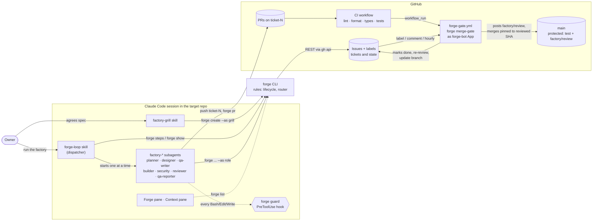

# Forge architecture

How forge-cloud works today (2026-11-05). This is a map of what runs, not a design proposal. The [README](../README.md) has the commands and setup steps; this page shows how the parts fit together and where the trust lines are.

**One sentence:** a Claude Code session runs the factory agents one at a time, the `forge` CLI refuses any ticket move the rules don't allow, GitHub labels hold the state, and a rules-only GitHub workflow acting as the forge-bot App is the only thing that merges.

## The picture



## Components

| Part | Where | What it does |
| --- | --- | --- |
| `forge` CLI | `src/` (TypeScript), installed globally from a forge-cloud clone | The rules. Every ticket change goes through it and is refused (exit 2) if the lifecycle doesn't allow it. `forge steps` prints the next agent step, `forge merge-gate` runs the rule steps. |
| Lifecycle | `src/lifecycle.ts`, `src/labels.ts` | Allowed moves per role, rounds, send-back reasons, gate results. |
| Router | `src/router.ts` | The routing table: state + labels gives the next step. Agent steps go to the session, rule steps (merge, mark done, re-review, update branch) go to the gate. Finish work before starting new work; lowest priority number first. |
| Tracker | `src/tracker/tracker.ts`, `github.ts`, `memory.ts` | Ticket storage behind one interface. GitHub Issues is the only real adapter; Jira could replace it. |
| CodeHost | `src/codehost.ts` | PRs, checks, statuses, merges. REST only, never GraphQL. |
| forge-loop skill | `skills/forge-loop/SKILL.md`, copied to `.claude/skills/` by `forge init` | The dispatcher. Loops `forge steps` → run that `factory-<role>` subagent → `forge show N` to confirm it moved. Never merges, never moves tickets itself. |
| Grill skill | `skills/factory-grill/` | Asks the owner one question at a time and files the spec (`type:spec`) with numbered `AC-n` criteria. |
| Agents | `agents/factory-*.md`, copied to `.claude/agents/` | Judgement. Planner, designer, QA writer (blind tests), builder, security (risky only), reviewer, QA reporter. Contract test: `src/agents.test.ts`. |
| Guard | `src/guard.ts`, hook in the target repo's `.claude/settings.json` | Keeps reviewer and security read-only, keeps the builder out of `tests/acceptance/` and `playwright.config.*`. Fails closed. |
| Merge gate | `templates/forge-gate.yml` → `.github/workflows/forge-gate.yml` | Runs `forge merge-gate` as the forge-bot App on `factory:*` label changes, ticket comments, finished CI runs and hourly. Builds forge from source each run. No Claude token. |
| CI | the target repo's own workflow (todo-app: lint, Prettier, `tsc --checkJs`, Playwright with 80% coverage floor) | Decides pass/fail. Uploads test evidence. |
| Panes | `plugins/forge-panel` (v0.3.0), `plugins/context-pane` | Claude Code mods. Forge pane: Needs you box, pipeline, tickets by state, running agents. Context pane: context use and prompt-cache hit rate. Read only. |
| `forge dispatch` | `src/dispatch.ts`, `src/runner.ts` | Older one-machine fallback: runs each agent as `claude -p` and merges itself. Not the main path; denied in todo-app's settings. |

## Ticket lifecycle and routing

```
spec ──planner──▶ planned ─designer─▶ designed ─qa-writer: tests-ready─▶ (builder) building ─CI green─▶ in-review
                                                                                                         │
     done ◀──gate merges── in-qa ◀──reviewer pass --sha (after security if risky)───────────────────────┘
       ▲                     │ qa-reporter posts evidence for head SHA
       │                     └─ send-back with reason, round +1 → building (flawed-test → designed)
       └── planner closes the spec or files follow-ups once every ticket is done

side states: blocked, needs-human (3rd send-back, or a question no agent can answer)
```

State lives in labels and body lines on the issue: `factory:<state>`, `type:spec`, `priority:pN`, `round:N`, `risky`, `qa:tests-ready`, `component:<name>`, `gate:security:pass|fail`, and body lines `Spec:`, `Covers:`, `Blocked by:`, `PR:`, `Reviewed: <sha>`. Notes, reviews and evidence are ticket comments headed by the role that wrote them. The full move table is in the README.

## Trust boundaries

What stops each party from doing more than its job:

1. **No Claude session merges.** The forge-loop skill forbids it, and the target repo's deny rules block `forge merge*`, `forge dispatch*`, `gh pr merge*`, `--as owner`, `--as system` and force pushes. Owner moves need a plain terminal.
2. **The gate judges nothing.** It merges only when the PR head equals `Reviewed: <sha>`, every check on that commit has passed, and the QA note names that commit. It posts `factory/review` just before merging (`reviewStatus: gate`) and merges over REST pinned to that SHA, so a late push makes GitHub refuse. Branch protection on `main` re-checks `test` + `factory/review` and up-to-date.
3. **A review covers one commit.** Any new commit (a push, or `main` merged in by the gate) sends the ticket back to `in-review` without spending a round.
4. **Reviewer and security are read-only by mechanism, not just by prompt.** The `forge guard` hook fires inside every subagent, picks the role from the subagent type, blocks writes, pushes, `--as` other roles, `$( )` and network outside localhost, and fails closed (`onFailure: "block"`, Claude Code ≥ 2.1.295). After each run the session checks `forge guard --ran <role> --since <time>` and stops if the hook never fired. These two are never run as general-purpose subagents.
5. **The builder can't grade its own work.** QA writer's blind tests can't be edited by the builder (guard), a bad test goes back as `flawed-test`, and the builder can't move to `in-review` until CI is green on its head.
6. **Risky tickets** (auth, permissions, payments, secrets, personal data, bulk deletes) pass a security gate first, still auto-merge, and leave a merge note for the owner.

## Data and logs

| Data | Where |
| --- | --- |
| Tickets, state, notes | GitHub issues, labels, comments |
| Code and tests | `ticket-N` branches and PRs; worktrees at `../worktrees/ticket-N`, removed by `forge clean`; the gate deletes the remote branch after merge |
| Test evidence | CI artifact `test-evidence`; per-test PNGs on the `factory-evidence` branch (Mac sessions only) |
| Event and run logs | `~/.factory/logs/<owner>/<repo>/events.jsonl` and `runs.jsonl` on whatever machine ran `forge`, copied by `forge logs push` to one folder per writer on the repo's `factory-logs` branch (gate after every run, forge-loop after every agent); `forge report` reads them all |
| Guard checks | `/tmp/factory/guard.log` |
| Agent scratch notes | `/tmp/factory/<role>-<N>.md` |

## What changed from earlier designs

Older docs still describe parts of this that no longer hold:

- **Mac mini dispatcher** (`forge dispatch --watch` running `claude -p` and merging itself): replaced by the forge-loop session plus the gate, because a Claude session that merges its own work is blocked. Still in the code as a fallback.
- **system-factory**: the frozen predecessor. Its `forge` has no `forge steps` or `forge merge-gate`; never install it.
- **Self-hosted Actions runner / Actions dispatcher**: dropped; the gate runs on GitHub-hosted runners and never runs an agent.
- **Reviewer posting `factory/review`**: only with `reviewStatus: reviewer` (the `forge dispatch` path). On the main path the gate posts it.

## Open gaps

- **No retro agent yet.** Logs now reach the `factory-logs` branch, but nothing reads them except `forge report`; the retro agent (phase 5) isn't built, and session runs have no exact cost.
- **QA evidence in cloud sessions:** the QA reporter gets 403 downloading the CI test-evidence artifact, so screenshots only reach the ticket from a Mac session.
- **One agent at a time.** No parallel slots, no ticket claim (`forge steps` returns the same step to every caller), shared ports and test data.
- **Roles are self-declared** with `--as`, and `Reviewed: <sha>` is a line in the issue body, so anyone with write access to the repo could fake a review pass. Fine for one owner, not for a team.
- **No unattended run.** The loop lives as long as the session does; `/goal`-style unattended runs, per-agent cost (`/usage`) and run caps are still open.
- **PRs that change the gate itself** need a manual `factory/review` status.
- **The reviewer guard log** hasn't yet been confirmed on a live reviewer run.
